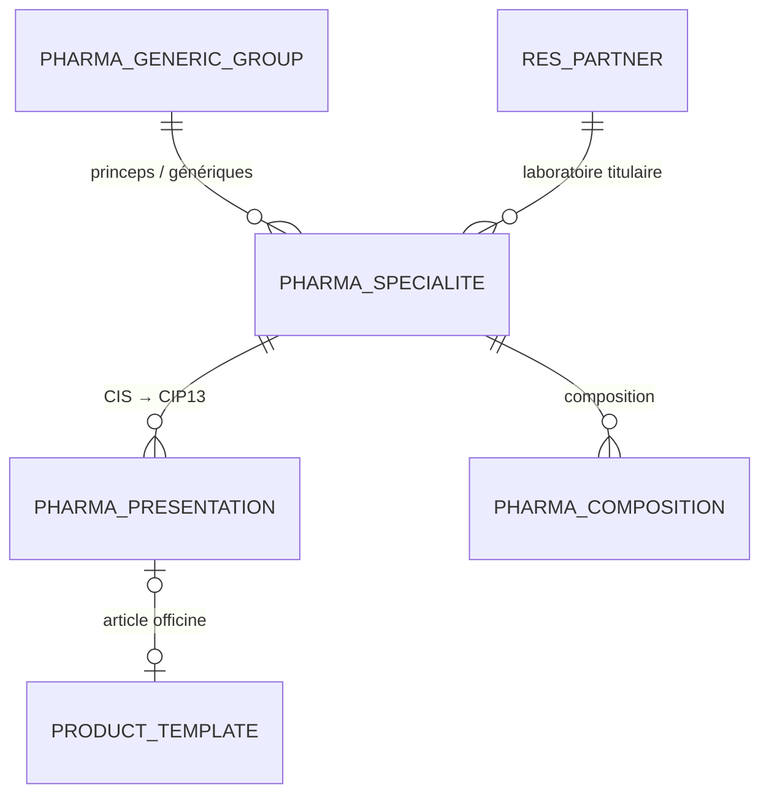

# odoo-pharma-fr

Modules **Odoo 19 Community** qui transforment l'ERP open source en **système de gestion
d'officine française** : référentiel médicament officiel, achats grossistes et laboratoires,
dispensation sur ordonnance et suivi réglementaire.

Ce dépôt est la **brique « source de données »** d'un projet d'analyse de données
(stock, rentabilité, génériques, ruptures) avec un suivi quotidien : ERP → cloud → tableaux de bord.

> Projet portfolio. Les données de démonstration sont fictives. Le référentiel médicament
> provient de la base publique officielle (BDPM), en réutilisation libre.

## Feuille de route

| Étape | Module | Contenu | État |
|---|---|---|---|
| 1 | `pharma_fr_base` | Base produits BDPM, fiche article officine (CIP13, remboursement, génériques, listes, TVA) | ✅ |
| 2 | `pharma_fr_purchase` | Grossistes-répartiteurs et commandes directes aux laboratoires, conditions commerciales, plafonds légaux de remise, réassort | ✅ |
| 3 | `pharma_fr_dispensation` | Ordonnances, patients, prescripteurs, tiers payant AMO / AMC, honoraires, substitution, facturation par payeur | ✅ |
| 4 | `pharma_fr_regulatory` | Registre des stupéfiants, ordonnancier, périmés (destruction) et retours patients | ✅ |
| 5 | `pharma_fr_analytics` | Pilotage : photos quotidiennes du stock, rentabilité et ABC, trésorerie prévisionnelle, fidélité, génériques par prescripteur, équipe, affluence, démarque inconnue | ✅ |
| 5 bis | `pharma_fr_services` | Missions de santé : vaccinations, TROD, bilans de médication, entretiens, facturées AMO / AMC | ✅ |
| 6 | Entrepôt de données | Export pseudonymisé vers BigQuery, modèle en étoile et tests avec dbt, tableau de bord Looker Studio ([détails](docs/entrepot_bigquery.md)) | ✅ |

## Étape 1 : `pharma_fr_base`

### Fonctionnalités

- **Import de la Base de Données Publique des Médicaments** (ANSM / HAS / UNCAM) :
  spécialités (CIS), présentations (CIP7 / CIP13, prix, taux de remboursement, honoraires),
  compositions, groupes génériques, conditions de prescription, ruptures et tensions
  d'approvisionnement, médicaments d'intérêt thérapeutique majeur (MITM).
  - assistant d'import (archive ZIP ou fichiers individuels), ou import automatique
    planifié depuis un répertoire du serveur ;
  - **import idempotent** : relancé à chaque publication, il n'écrit que les différences,
    en regroupant les écritures identiques ;
  - gestion des **encodages mélangés** (UTF-8 / Windows-1252) et des deux formats du fichier
    des présentations (11 ou 13 colonnes).
- **Classification réglementaire** déduite des conditions de prescription : liste I, liste II,
  stupéfiant, règles des stupéfiants (assimilés), réservé à l'usage hospitalier, prescription restreinte.
- **Référencement des présentations comme articles officine** (en masse ou à l'unité) :
  code-barres CIP13, suivi par lot et date de péremption, laboratoire titulaire,
  catégorie (remboursable / non remboursable / parapharmacie / dispositif médical),
  **régime de prix** (réglementé / libre) et **TVA officine** (2,1 % / 5,5 % / 10 % / 20 %)
  avec affectation automatique des taxes du plan comptable français (prix publics TTC).
- Menus **Pharmacie** : articles officine, spécialités, présentations, groupes génériques,
  laboratoires ; filtres prêts pour l'analyse (génériques / princeps, listes, ruptures, catégories).
- Deux rôles : **préparateur / pharmacien adjoint** (lecture du référentiel) et
  **pharmacien titulaire** (import, référencement).

### Modèle de données



Le **référentiel** (`pharma.specialite`, `pharma.presentation`) contient toute la base publique,
soit environ 15 000 spécialités et 20 000 présentations. Seules les présentations que
l'officine référence deviennent des **articles** (`product.template`), comme dans un logiciel
de gestion d'officine.

### Structure

```
pharma_fr_base/
├── lib/bdpm.py              # parseurs BDPM en Python pur (réutilisables hors Odoo)
├── models/
│   ├── pharma_specialite.py, pharma_presentation.py, pharma_generic_group.py, pharma_composition.py
│   ├── pharma_bdpm_importer.py   # import idempotent (upsert + écritures groupées)
│   ├── product_template.py       # fiche article officine, TVA, régime de prix
│   └── res_partner.py            # laboratoires / grossistes
├── wizard/                  # assistant d'import
├── views/  security/  data/
└── tests/                   # tests (parseur, import, articles) et jeu de données BDPM fictif
```

## Étape 2 : `pharma_fr_purchase`

- **Fournisseurs de l'officine** : grossistes-répartiteurs (grossiste principal, nombre de
  livraisons par jour, franco) et laboratoires en commande directe. Le **type de commande**
  (grossiste / directe) est déduit du fournisseur, ce qui permet de suivre la répartition
  des achats.
- **Conditions commerciales** datées par fournisseur, avec une remise immédiate (sur facture)
  et une remise différée (ristourne, coopération commerciale) :
  - la remise peut porter sur tous les produits, un segment (génériques, remboursables hors
    génériques, non remboursables, parapharmacie, dispositifs médicaux), un laboratoire ou
    un article, avec une quantité minimum ;
  - la condition la plus spécifique s'applique automatiquement aux lignes de commande.
- **Plafonds légaux de remise** (art. L. 138-9 du code de la sécurité sociale), dans un
  **barème daté** : chaque commande applique le plafond en vigueur à sa date. Pour une
  spécialité remboursable, l'avantage total (remise immédiate et différée) est ramené au
  plafond. Une alerte signale toute remise saisie à la main au-delà de la limite.
  > Les plafonds évoluent : un arrêté du 4 août 2025 prévoyait de les abaisser, puis son
  > application a été suspendue. Les valeurs fournies (2,5 % / 40 % / 20 %) sont à vérifier
  > dans *Pharmacie → Configuration → Plafonds de remise*, où l'on ajoute une ligne datée
  > à chaque évolution.
- **Prix net net** par ligne (après remises immédiate et différée) et **remises différées
  attendues** par commande : c'est le coût d'achat réel qui sert au calcul de la marge.
- **Alerte franco** sur les commandes en cours, avec le montant manquant.
- **Calcul des seuils de réassort** à partir des ventes réelles :
  - mini = consommation × (délai fournisseur + sécurité) ;
  - maxi = mini + consommation × couverture.
  Le calcul crée ou met à jour les règles de réapprovisionnement Odoo (déclenchement
  automatique, route « Acheter ») et peut remettre à zéro les produits dormants.

Simplifications : le plafond est contrôlé ligne par ligne, sur le prix d'achat considéré
comme prix fabricant HT. La loi l'apprécie par année civile et par ligne de produits.

## Étape 3 : `pharma_fr_dispensation`

- **Patients** :
  - numéro de sécurité sociale contrôlé (format et clé, y compris les départements 2A / 2B) ;
  - caisse d'assurance maladie (AMO) et complémentaire santé (AMC), avec la garantie
    souscrite (ticket modérateur, hors médicaments à 15 %) ;
  - exonérations (ALD, C2S) et tiers payant.
- **Prescripteurs** (numéro RPPS, spécialité) et **organismes payeurs**.
- **Ordonnances** (simple, bizone ALD, sécurisée). Pour chaque ligne, le module calcule
  automatiquement :
  - le prix public, l'honoraire à la boîte (issu de la BDPM) et la base de remboursement ;
  - la **répartition entre AMO, AMC et patient**, avec exonération des lignes ALD
    (partie haute de l'ordonnance bizone).
- **Substitution générique** :
  - suivi des lignes substituées (princeps prescrit, générique délivré) et du taux de
    génériques par ordonnance ;
  - en cas de **refus de substitution**, remboursement sur la base du générique le plus cher
    au même conditionnement et pas de tiers payant, sauf mention « non substituable ».
- **Honoraires d'ordonnance** dans un **barème daté** : exécution d'ordonnance, âge
  (moins de 3 ans, 70 ans et plus), ordonnance complexe (5 lignes et plus, exonérée du
  ticket modérateur) et médicaments spécifiques (stupéfiants et assimilés).
  > Montants fournis : 0,61 € et 1,68 € (au 1er janvier 2026), 0,30 € et 3,57 €, avec un taux
  > AMO de 70 % par défaut. Ils sont à vérifier dans
  > *Pharmacie → Configuration → Honoraires de dispensation*.
- **Contrôles avant délivrance** :
  - prescripteur obligatoire pour un médicament listé ou remboursable ;
  - ordonnance de plus de 3 mois refusée pour une première délivrance ;
  - ordonnance sécurisée exigée pour les stupéfiants et assimilés ;
  - médicaments réservés à l'usage hospitalier bloqués ;
  - stock insuffisant ou lots périmés bloqués.
- **Délivrance** :
  - sortie de stock en **FEFO** (premier périmé, premier sorti), avec les lots tracés sur
    l'ordonnance ;
  - **une facture par payeur** (AMO, AMC, patient), comptabilisée avec la TVA de chaque
    article (2,1 % sur les médicaments remboursables et les honoraires) ;
  - **coût d'achat et marge brute** enregistrés par ligne.
- **Facturation** : une facture par payeur et par ordonnance, ou **bordereaux
  journaliers** (une facture par organisme et par jour, parts patients regroupées comme
  un ticket Z de caisse), selon un réglage de la société.
- **Manquants** : demandes non servies (vente perdue, délivrance différée, produit
  remplacé), avec leur motif (stock de l'officine, rupture nationale, fournisseur) et le
  montant non servi.
- **Analyse** : vues tableau croisé et graphique du chiffre d'affaires, des honoraires
  et de la marge, par jour, article ou prescripteur.

Hors périmètre : télétransmission SESAM-Vitale (FSE) et franchises médicales (recouvrées
par l'assurance maladie). Le projet vise une officine d'Île-de-France, qui relève du régime
général : le régime local d'Alsace-Moselle n'est pas modélisé.

## Étape 4 : `pharma_fr_regulatory`

- **Registre des stupéfiants** : chaque entrée et sortie de stupéfiant est inscrite
  automatiquement dès qu'un mouvement de stock est validé. Cela couvre :
  - les réceptions fournisseur, les délivrances, les retours patient et fournisseur ;
  - les destructions et les régularisations d'inventaire.

  Chaque ligne indique le numéro d'ordre par produit, les lots, le patient ou le
  fournisseur, le prescripteur et le **stock après opération**. Le registre ne peut être
  ni modifié ni supprimé, et s'imprime en PDF.
- **Ordonnancier** : chaque délivrance de médicament de la liste I, de la liste II ou
  stupéfiant est transcrite avec une numérotation chronologique. Les noms et adresses du
  patient et du prescripteur, le RPPS, le produit, la quantité et les lots y sont figés
  au moment de la délivrance. L'ordonnancier n'est pas modifiable et s'imprime en PDF.
- **Péremptions** : liste des lots périmés ou qui périment sous 3 ou 6 mois, avec leur
  valeur, et un assistant de **destruction des périmés** (mise au rebut avec le motif
  « Périmé »). Cela donne la **valeur détruite**, un indicateur de pilotage du stock.
- **Retours patients** :
  - des **avoirs** sont émis pour chaque payeur ;
  - les lots reviennent en stock, puis sont **détruits** (un médicament rapporté par un
    patient ne peut pas être redélivré), sauf remise en stock explicite si le produit
    n'a pas quitté l'officine ;
  - le retour et la destruction apparaissent au registre des stupéfiants.

Le registre compte les quantités en boîtes (unité de l'article). Un registre tenu en
unités de prise demanderait une unité de mesure dédiée par article.

## Étape 5 : `pharma_fr_analytics`

**Photo quotidienne du stock** : chaque soir, une tâche planifiée enregistre pour chaque
article :
- la quantité et la valeur au coût ;
- les ventes sur 30 jours, la demande moyenne et la **couverture en jours** ;
- la quantité et la valeur qui **périment sous 90 jours**, ainsi que les quantités périmées ;
- la date de dernière vente, et les indicateurs **dormant** (sans vente depuis 60 jours),
  **rupture officine** et **rupture nationale**.

Odoo ne garde que le stock du moment : cette table fournit l'historique nécessaire au
suivi quotidien (évolution de la valeur du stock, rotation, surstock). Elle se consulte
dans *Pharmacie → Pilotage → Suivi quotidien du stock*, en vues graphique, tableau croisé
ou liste.

**Menu Pharmacie → Pilotage** (vues SQL alimentées par les données de l'ERP) :

| Analyse | Question à laquelle elle répond |
|---|---|
| Suivi quotidien du stock | Combien vaut mon stock, combien de jours de couverture, que va périmer ? |
| Rentabilité | Quels rayons, laboratoires et articles font ma marge ? Classement **ABC** par marge, **GMROI** (marge / stock moyen) |
| Trésorerie | Quel solde dans 60 jours ? Encaissements attendus (délai réel de chaque payeur) et échéances fournisseurs |
| Fidélité | Quels patients sont nouveaux, actifs, **à risque** ou **perdus** (plus de passage depuis 1,5 fois leur rythme) ? |
| Génériques par prescripteur | Quel médecin freine la substitution (mentions « non substituable ») ? |
| Équipe | Chiffre, panier moyen, part du conseil et des ventes additionnelles par **vendeur** |
| Affluence | Passages par heure et par jour de la semaine, pour caler les plannings |
| Écarts d'inventaire | **Démarque inconnue** relevée par les inventaires tournants, valorisée au coût |

Compléments dans les modules métier :
- chaque vente porte son **vendeur**, son heure et son jour (`seller_id`, `dispensing_hour`,
  `dispensing_weekday`) ;
- les manquants « à rendre » ont un cycle de vie : ouvert → **rendu** (avec le délai) ou
  annulé ;
- chaque payeur a un **délai de paiement** paramétrable, utilisé par la trésorerie ;
- toute validation d'inventaire enregistre l'écart (quantité et valeur) et son motif.

## Étape 5 bis : `pharma_fr_services`

Les **missions de santé** de l'officine, hors délivrance : vaccinations (grippe, Covid,
autres), TROD angine, bilans partagés de médication, entretiens (anticoagulants, femmes
enceintes, asthme). Chaque acte est rattaché au patient et au pharmacien, et facturé à
l'AMO et à l'AMC selon le taux de prise en charge du type de mission. Les tarifs fournis
sont indicatifs et **à vérifier** auprès de la convention pharmaceutique en vigueur.

## Étape 6 : entrepôt de données (BigQuery, dbt, Looker Studio)

Les données sortent d'Odoo chaque soir vers un entrepôt BigQuery appartenant à la
pharmacie, sans aucune donnée identifiante de patient (clé pseudonyme HMAC calculée sur le
poste). dbt y construit un **modèle en étoile** (6 dimensions, 11 faits dont les faits
journaliers de stock et de trésorerie) puis 15 tables prêtes pour un tableau de bord
**Looker Studio** en quatre pages : Journée, Stock, Argent, Patients.

```bash
./scripts/pipeline.sh pharmacie2      # export → BigQuery → dbt build (modèles + 75 tests)
```

- Mise en place et architecture : [docs/entrepot_bigquery.md](docs/entrepot_bigquery.md)
- Tableau de bord, page par page : [docs/tableau_de_bord_looker.md](docs/tableau_de_bord_looker.md)
- Projet dbt : [dbt/README.md](dbt/README.md)

## Données de démonstration

`scripts/generate_demo_data.py` simule plusieurs mois d'activité d'une officine
parisienne. Il s'exécute dans le shell Odoo, sur une base où les modules sont installés
et la BDPM importée :

```bash
docker compose exec -T odoo odoo shell -d pharmacie --no-http \
    --db_host=db --db_user=odoo --db_password=odoo < scripts/generate_demo_data.py
```

Options, à passer avec `-e` après `exec -T` :
- `DEMO_MONTHS=3` : mois complets simulés (défaut 3), ou `DEMO_DAYS=90` ;
- `DEMO_SCALE=2` : volume d'activité, environ 100 passages par jour ouvré par défaut ;
- `DEMO_SEED=42` : reproductibilité.

Durée indicative : environ 45 minutes pour 3 mois à l'échelle 2.

**Fonctionnement**
- L'horloge d'Odoo est simulée (freezegun) : stock, factures, registres et ordonnancier
  portent les dates simulées.
- Le script met en place l'assortiment (molécules courantes : princeps et génériques,
  conseils, parapharmacie), les grossistes et le génériqueur, les conditions
  commerciales, 800 patients fictifs (NIR valides), des prescripteurs et le stock
  d'ouverture.
- Une **équipe** de 5 personnes (titulaire, adjoint, trois préparateurs) aux profils de
  vente différents : certaines proposent davantage de conseil associé aux ordonnances.
- Chaque jour d'ouverture, il simule une journée **heure par heure** (8 h 30 – 19 h 30,
  pics de fin de matinée et de fin de journée) :
  - à l'ouverture : périmés, réceptions, **inventaire tournant le lundi**, commande ;
  - vers midi : livraison du grossiste, dépannages, puis délivrance des **produits
    promis** (abandonnés au-delà de 5 jours) ;
  - les **missions de santé** : TROD plus fréquents à l'automne, campagne de vaccination
    antigrippale à partir de la mi-octobre, entretiens et bilans ;
  - les réceptions et la commande de réassort ;
  - les renouvellements des patients chroniques, les ordonnances ponctuelles et les
    ventes au comptoir ;
  - les dépannages et les manquants ;
  - les retours, la destruction des périmés et les bordereaux de facturation ;
  - les **encaissements** (comptoir le jour même, AMO sous quelques jours, mutuelles sous
    1 à 4 semaines, quelques rejets partiels qui laissent des créances ouvertes) ;
  - les **factures fournisseurs** à réception et leurs **règlements** (grossistes le 10 du
    mois suivant, laboratoire à 60 jours, parapharmacie à 30 jours) ;
  - la photo quotidienne du stock.
- **Prix d'achat** :
  - pour les médicaments remboursables, ils sont déduits du prix public par le barème
    réglementé : PFHT, marge dégressive lissée de l'officine (barème 2020) et marge du
    grossiste (approximation) ;
  - les commandes directes au laboratoire sont facturées au PFHT ;
  - le conseil et la parapharmacie ont une marge commerciale libre.
- **Problèmes introduits volontairement** pour l'analyse :
  - surstock (commandes directes trop généreuses, produits dormants) ;
  - péremptions ;
  - ruptures nationales mal livrées ;
  - dépannages chez le second grossiste, plus chers ;
  - substitution générique freinée par un prescripteur ;
  - commandes sous le franco ;
  - **démarque inconnue** en parapharmacie (libre accès) ;
  - **patients chroniques qui partent** chez un confrère en cours de période ;
  - écarts de performance entre vendeurs.

Toutes les personnes et organismes privés sont fictifs. Les coûts d'achat sont estimés.

## Installation

### Avec Docker

```bash
git clone https://github.com/DorianKi/odoo-pharma-fr.git && cd odoo-pharma-fr
./scripts/download_bdpm.sh            # télécharge la BDPM dans ./bdpm (+ bdpm.zip)
docker compose up -d                  # Odoo 19 + PostgreSQL 16 → http://localhost:8069
```

1. Créez une base de données en choisissant le pays **France** (plan comptable et TVA françaises).
2. **Applications** (retirez le filtre « Applications ») → installez **« Pharmacie FR - Pilotage »** : il installe aussi tous les autres modules.
3. **Pharmacie → Configuration → Import BDPM** : déposez `bdpm/bdpm.zip` et choisissez
   les articles à créer (par exemple, toutes les présentations commercialisées et remboursables).

### Mise à jour automatique

Renseignez le paramètre système `pharma_fr_base.bdpm_directory` (par exemple `/mnt/bdpm`),
puis activez la tâche planifiée **« Pharmacie : mise à jour de la base BDPM »**. La base est
alors relue chaque mois depuis ce répertoire, alimenté par `scripts/download_bdpm.sh`.

### Tests

```bash
odoo -d test -i pharma_fr_analytics --stop-after-init \
     --test-tags=/pharma_fr_base,/pharma_fr_purchase,/pharma_fr_dispensation,/pharma_fr_regulatory,/pharma_fr_services,/pharma_fr_analytics
python -m doctest -v pharma_fr_base/lib/bdpm.py   # parseur seul, sans Odoo
```

L'intégration continue (GitHub Actions) exécute le lint (ruff), les doctests du parseur
et les tests Odoo.

## Limites

Ce projet ne remplace pas un logiciel de gestion d'officine agréé. Il ne prend pas en charge
SESAM-Vitale (FSE), le dossier pharmaceutique ni la sérialisation (France MVO), et les bases
commerciales (Vidal, Thériaque) ne sont pas incluses.

## Source des données

Base de données publique des médicaments : <https://base-donnees-publique.medicaments.gouv.fr>.
La date de mise à jour des fichiers importés est conservée dans le paramètre système
`pharma_fr_base.bdpm_last_import`.

## Licence

LGPL-3.0, comme Odoo Community.
