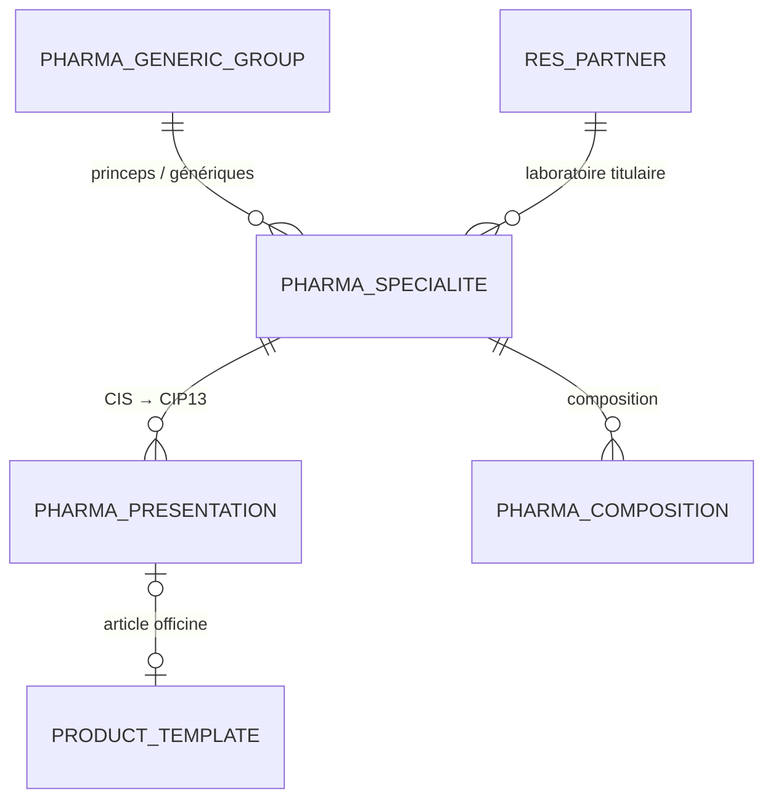

# odoo-pharma-fr

Modules **Odoo 19 Community** qui transforment l'ERP open source en **système de gestion
d'officine française** : référentiel médicament officiel, achats grossistes et laboratoires,
dispensation sur ordonnance et suivi réglementaire.

Ce dépôt est la **brique « source de données »** d'un projet d'analyse de données
(stock, rentabilité, génériques, ruptures) avec un suivi quotidien : ERP → cloud → tableaux de bord.

> Projet portfolio. Les données de démonstration sont fictives. Le référentiel médicament
> provient de la base publique officielle (BDPM), en réutilisation libre.

## Feuille de route

| Étape | Module | Contenu | État |
|---|---|---|---|
| 1 | `pharma_fr_base` | Base produits BDPM, fiche article officine (CIP13, remboursement, génériques, listes, TVA) | ✅ |
| 2 | `pharma_fr_purchase` | Grossistes-répartiteurs et commandes directes aux laboratoires, remises, réassort | 🔜 |
| 3 | `pharma_fr_dispensation` | Ordonnances, patients, prescripteurs, tiers payant AMO / AMC, honoraires | 🔜 |
| 4 | `pharma_fr_regulatory` | Registre des stupéfiants, ordonnancier, périmés et retours | 🔜 |

## Étape 1 : `pharma_fr_base`

### Fonctionnalités

- **Import de la Base de Données Publique des Médicaments** (ANSM / HAS / UNCAM) :
  spécialités (CIS), présentations (CIP7 / CIP13, prix, taux de remboursement, honoraires),
  compositions, groupes génériques, conditions de prescription, ruptures et tensions
  d'approvisionnement, médicaments d'intérêt thérapeutique majeur (MITM).
  - assistant d'import (archive ZIP ou fichiers individuels), ou import automatique
    planifié depuis un répertoire du serveur ;
  - **import idempotent** : relancé à chaque publication, il n'écrit que les différences,
    en regroupant les écritures identiques ;
  - gestion des **encodages mélangés** (UTF-8 / Windows-1252) et des deux formats du fichier
    des présentations (11 ou 13 colonnes).
- **Classification réglementaire** déduite des conditions de prescription : liste I, liste II,
  stupéfiant, règles des stupéfiants (assimilés), réservé à l'usage hospitalier, prescription restreinte.
- **Référencement des présentations comme articles officine** (en masse ou à l'unité) :
  code-barres CIP13, suivi par lot et date de péremption, laboratoire titulaire,
  catégorie (remboursable / non remboursable / parapharmacie / dispositif médical),
  **régime de prix** (réglementé / libre) et **TVA officine** (2,1 % / 5,5 % / 10 % / 20 %)
  avec affectation automatique des taxes du plan comptable français (prix publics TTC).
- Menus **Pharmacie** : articles officine, spécialités, présentations, groupes génériques,
  laboratoires ; filtres prêts pour l'analyse (génériques / princeps, listes, ruptures, catégories).
- Deux rôles : **préparateur / pharmacien adjoint** (lecture du référentiel) et
  **pharmacien titulaire** (import, référencement).

### Modèle de données



Le **référentiel** (`pharma.specialite`, `pharma.presentation`) contient toute la base publique,
soit environ 15 000 spécialités et 20 000 présentations. Seules les présentations que
l'officine référence deviennent des **articles** (`product.template`), comme dans un logiciel
de gestion d'officine.

### Structure

```
pharma_fr_base/
├── lib/bdpm.py              # parseurs BDPM en Python pur (réutilisables hors Odoo)
├── models/
│   ├── pharma_specialite.py, pharma_presentation.py, pharma_generic_group.py, pharma_composition.py
│   ├── pharma_bdpm_importer.py   # import idempotent (upsert + écritures groupées)
│   ├── product_template.py       # fiche article officine, TVA, régime de prix
│   └── res_partner.py            # laboratoires / grossistes
├── wizard/                  # assistant d'import
├── views/  security/  data/
└── tests/                   # 17 tests (parseur + import + articles) et jeu de données BDPM fictif
```

## Installation

### Avec Docker

```bash
git clone https://github.com/DorianKi/odoo-pharma-fr.git && cd odoo-pharma-fr
./scripts/download_bdpm.sh            # télécharge la BDPM dans ./bdpm (+ bdpm.zip)
docker compose up -d                  # Odoo 19 + PostgreSQL 16 → http://localhost:8069
```

1. Créez une base de données en choisissant le pays **France** (plan comptable et TVA françaises).
2. **Applications** → installez « Pharmacie FR - Base produits (BDPM) ».
3. **Pharmacie → Configuration → Import BDPM** : déposez `bdpm/bdpm.zip` et choisissez
   les articles à créer (par exemple, toutes les présentations commercialisées et remboursables).

### Mise à jour automatique

Renseignez le paramètre système `pharma_fr_base.bdpm_directory` (par exemple `/mnt/bdpm`),
puis activez la tâche planifiée **« Pharmacie : mise à jour de la base BDPM »**. La base est
alors relue chaque mois depuis ce répertoire, alimenté par `scripts/download_bdpm.sh`.

### Tests

```bash
odoo -d test -i pharma_fr_base --test-tags=/pharma_fr_base --stop-after-init
python -m doctest -v pharma_fr_base/lib/bdpm.py   # parseur seul, sans Odoo
```

L'intégration continue (GitHub Actions) exécute le lint (ruff), les doctests du parseur
et les tests Odoo.

## Limites

Ce projet ne remplace pas un logiciel de gestion d'officine agréé. Il ne prend pas en charge
SESAM-Vitale (FSE), le dossier pharmaceutique ni la sérialisation (France MVO), et les bases
commerciales (Vidal, Thériaque) ne sont pas incluses.

## Source des données

Base de données publique des médicaments : <https://base-donnees-publique.medicaments.gouv.fr>.
La date de mise à jour des fichiers importés est conservée dans le paramètre système
`pharma_fr_base.bdpm_last_import`.

## Licence

LGPL-3.0, comme Odoo Community.
